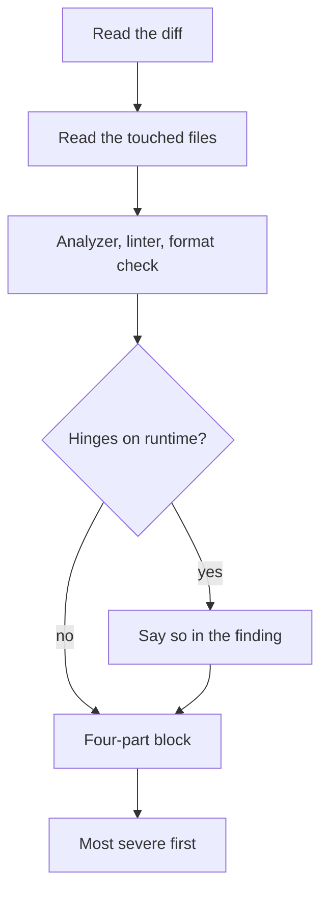

<div align="center">

# review-findings

**Every code review finding in one shape, ready to paste.**

An [Agent Skills](https://agentskills.io) skill: one inline pass, static checks only, and each
finding as severity, code, failure scenario, and a comment you can post as-is.

[![Validate][badge-validate]][link-validate]
[![Release][badge-release]][link-releases]
[![License][badge-license]](LICENSE)
[![Agent Skills][badge-agent-skills]](https://agentskills.io)

[![Claude Code][badge-claude-code]](#install)
[![Codex][badge-codex]](#install)
[![Gemini CLI][badge-gemini-cli]](#install)
[![GitHub Copilot][badge-github-copilot]](#install)
[![Cursor][badge-cursor]](#install)
[![Windsurf][badge-windsurf]](#install)
[![Cline][badge-cline]](#install)

</div>

## What it teaches your agent

| Rule | Why |
| --- | --- |
| **One direct inline pass**: the diff, then the touched files | The review stays fast and its reasoning stays in view |
| **Static checks only**: analyzer, linter, format check, reading the tests | Running the suite or a multi-agent review spends time nobody asked to spend |
| **Four parts per finding**: severity with `file:line`, the code, the failure scenario, a paste-ready comment | Each finding can be judged and posted without rewriting |
| **Most severe first**, from four fixed levels | The first finding is the one to fix first |
| **A concrete failure scenario**, never "this is inconsistent" | A risk can only be weighed once it is named |
| **Scope gaps as prose**, with no made-up `file:line` | A file missing from the diff has no line to point at |

Other review tools may still find the issues; their findings are reported in this shape too.

## How it works



## Example

One finding, as the skill writes it:

> **[HIGH]** `src/cart/total.ts:42`
>
> ```ts
> const total = items.reduce((sum, item) => sum + item.price, 0);
> ```
>
> The total adds each line's `price` but ignores `quantity`, so a cart holding two of the same
> item charges for one. Every order with a quantity above one is undercharged, silently.
>
> Paste ready comment: This sums `price` without `quantity`, so a line with two items is charged
> once. Suggest `sum + item.price * item.quantity`, plus a test for a line with quantity 2.

## Install

| Agent | Command |
| --- | --- |
| ![Claude Code][badge-claude-code] | `/plugin marketplace add ArefMozafari/review-findings`<br>`/plugin install review-findings@review-findings` |
| ![Gemini CLI][badge-gemini-cli] | `gemini extensions install https://github.com/ArefMozafari/review-findings` |
| ![GitHub Copilot CLI][badge-github-copilot-cli] | `copilot plugin marketplace add ArefMozafari/review-findings`<br>`copilot plugin install review-findings@review-findings` |
| ![Cursor][badge-cursor] | `agent plugin marketplace add https://github.com/ArefMozafari/review-findings`<br>then `/plugins` in `agent` and install `review-findings` |
| ![Codex][badge-codex] ![Cursor][badge-cursor] ![Windsurf][badge-windsurf] ![Cline][badge-cline] and more | `npx skills add ArefMozafari/review-findings` |
| ![GitHub CLI][badge-github-cli] for Copilot and other agents | `gh skill install ArefMozafari/review-findings` |

<details>
<summary><b>Manual install</b></summary>

<br>

Copy the `skills/review-findings` folder into your agent's skills directory:

| Agent | Directory |
| --- | --- |
| Claude Code | `~/.claude/skills/` |
| Codex, Gemini CLI, GitHub Copilot, Cursor, Windsurf, OpenCode, Goose, Amp | `~/.agents/skills/` |
| Cline | `~/.cline/skills/` |

</details>

<details>
<summary><b>Development</b></summary>

<br>

Every push is checked by [`.github/workflows/validate.yml`](.github/workflows/validate.yml).
To run the skill and Claude Code checks locally from the repository root:

```bash
uvx --from skills-ref==0.1.1 agentskills validate skills/review-findings
claude plugin validate --strict .claude-plugin/marketplace.json
claude plugin validate --strict .claude-plugin/plugin.json
```

The workflow also checks the Gemini manifest's fields and validates the Cursor manifests against
the JSON schemas Cursor publishes.

</details>

## More skills

- [pr-evidence](https://github.com/ArefMozafari/pr-evidence): make every pull request show its
  change, not describe it.
- [review-replies](https://github.com/ArefMozafari/review-replies): answer review comments on your
  own pull request one thread at a time.
- [post-merge-cleanup](https://github.com/ArefMozafari/post-merge-cleanup): clean up branches,
  worktrees, and stale notes once a pull request has merged.

## License

MIT. See [LICENSE](LICENSE).

<!-- Badge images are defined once here and reused by the header and the install table. -->

[link-validate]: https://github.com/ArefMozafari/review-findings/actions/workflows/validate.yml
[link-releases]: https://github.com/ArefMozafari/review-findings/releases
[badge-validate]: https://github.com/ArefMozafari/review-findings/actions/workflows/validate.yml/badge.svg
[badge-release]: https://img.shields.io/github/v/release/ArefMozafari/review-findings
[badge-license]: https://img.shields.io/github/license/ArefMozafari/review-findings
[badge-agent-skills]: https://img.shields.io/badge/Agent_Skills-compatible-blue
[badge-claude-code]: https://img.shields.io/badge/Claude_Code-24292F?logo=claude&logoColor=white
[badge-gemini-cli]: https://img.shields.io/badge/Gemini_CLI-24292F?logo=googlegemini&logoColor=white
[badge-github-copilot]: https://img.shields.io/badge/GitHub_Copilot-24292F?logo=githubcopilot&logoColor=white
[badge-github-copilot-cli]: https://img.shields.io/badge/GitHub_Copilot_CLI-24292F?logo=githubcopilot&logoColor=white
[badge-cursor]: https://img.shields.io/badge/Cursor-24292F?logo=cursor&logoColor=white
[badge-windsurf]: https://img.shields.io/badge/Windsurf-24292F?logo=windsurf&logoColor=white
[badge-cline]: https://img.shields.io/badge/Cline-24292F?logo=cline&logoColor=white
[badge-github-cli]: https://img.shields.io/badge/GitHub_CLI-24292F?logo=github&logoColor=white

<!-- Shields.io's icon set has no OpenAI logo, so the Codex badge embeds the simple-icons SVG. -->

[badge-codex]: https://img.shields.io/badge/Codex-24292F?logo=data:image/svg%2bxml;base64,PHN2ZyBmaWxsPSJ3aGl0ZSIgcm9sZT0iaW1nIiB2aWV3Qm94PSIwIDAgMjQgMjQiIHhtbG5zPSJodHRwOi8vd3d3LnczLm9yZy8yMDAwL3N2ZyI+PHRpdGxlPk9wZW5BSTwvdGl0bGU+PHBhdGggZD0iTTIyLjI4MTkgOS44MjExYTUuOTg0NyA1Ljk4NDcgMCAwIDAtLjUxNTctNC45MTA4IDYuMDQ2MiA2LjA0NjIgMCAwIDAtNi41MDk4LTIuOUE2LjA2NTEgNi4wNjUxIDAgMCAwIDQuOTgwNyA0LjE4MThhNS45ODQ3IDUuOTg0NyAwIDAgMC0zLjk5NzcgMi45IDYuMDQ2MiA2LjA0NjIgMCAwIDAgLjc0MjcgNy4wOTY2IDUuOTggNS45OCAwIDAgMCAuNTExIDQuOTEwNyA2LjA1MSA2LjA1MSAwIDAgMCA2LjUxNDYgMi45MDAxQTUuOTg0NyA1Ljk4NDcgMCAwIDAgMTMuMjU5OSAyNGE2LjA1NTcgNi4wNTU3IDAgMCAwIDUuNzcxOC00LjIwNTggNS45ODk0IDUuOTg5NCAwIDAgMCAzLjk5NzctMi45MDAxIDYuMDU1NyA2LjA1NTcgMCAwIDAtLjc0NzUtNy4wNzI5em0tOS4wMjIgMTIuNjA4MWE0LjQ3NTUgNC40NzU1IDAgMCAxLTIuODc2NC0xLjA0MDhsLjE0MTktLjA4MDQgNC43NzgzLTIuNzU4MmEuNzk0OC43OTQ4IDAgMCAwIC4zOTI3LS42ODEzdi02LjczNjlsMi4wMiAxLjE2ODZhLjA3MS4wNzEgMCAwIDEgLjAzOC4wNTJ2NS41ODI2YTQuNTA0IDQuNTA0IDAgMCAxLTQuNDk0NSA0LjQ5NDR6bS05LjY2MDctNC4xMjU0YTQuNDcwOCA0LjQ3MDggMCAwIDEtLjUzNDYtMy4wMTM3bC4xNDIuMDg1MiA0Ljc4MyAyLjc1ODJhLjc3MTIuNzcxMiAwIDAgMCAuNzgwNiAwbDUuODQyOC0zLjM2ODV2Mi4zMzI0YS4wODA0LjA4MDQgMCAwIDEtLjAzMzIuMDYxNUw5Ljc0IDE5Ljk1MDJhNC40OTkyIDQuNDk5MiAwIDAgMS02LjE0MDgtMS42NDY0ek0yLjM0MDggNy44OTU2YTQuNDg1IDQuNDg1IDAgMCAxIDIuMzY1NS0xLjk3MjhWMTEuNmEuNzY2NC43NjY0IDAgMCAwIC4zODc5LjY3NjVsNS44MTQ0IDMuMzU0My0yLjAyMDEgMS4xNjg1YS4wNzU3LjA3NTcgMCAwIDEtLjA3MSAwbC00LjgzMDMtMi43ODY1QTQuNTA0IDQuNTA0IDAgMCAxIDIuMzQwOCA3Ljg3MnptMTYuNTk2MyAzLjg1NThMMTMuMTAzOCA4LjM2NCAxNS4xMTkyIDcuMmEuMDc1Ny4wNzU3IDAgMCAxIC4wNzEgMGw0LjgzMDMgMi43OTEzYTQuNDk0NCA0LjQ5NDQgMCAwIDEtLjY3NjUgOC4xMDQydi01LjY3NzJhLjc5Ljc5IDAgMCAwLS40MDctLjY2N3ptMi4wMTA3LTMuMDIzMWwtLjE0Mi0uMDg1Mi00Ljc3MzUtMi43ODE4YS43NzU5Ljc3NTkgMCAwIDAtLjc4NTQgMEw5LjQwOSA5LjIyOTdWNi44OTc0YS4wNjYyLjA2NjIgMCAwIDEgLjAyODQtLjA2MTVsNC44MzAzLTIuNzg2NmE0LjQ5OTIgNC40OTkyIDAgMCAxIDYuNjgwMiA0LjY2ek04LjMwNjUgMTIuODYzbC0yLjAyLTEuMTYzOGEuMDgwNC4wODA0IDAgMCAxLS4wMzgtLjA1NjdWNi4wNzQyYTQuNDk5MiA0LjQ5OTIgMCAwIDEgNy4zNzU3LTMuNDUzN2wtLjE0Mi4wODA1TDguNzA0IDUuNDU5YS43OTQ4Ljc5NDggMCAwIDAtLjM5MjcuNjgxM3ptMS4wOTc2LTIuMzY1NGwyLjYwMi0xLjQ5OTggMi42MDY5IDEuNDk5OHYyLjk5OTRsLTIuNTk3NCAxLjQ5OTctMi42MDY3LTEuNDk5N1oiLz48L3N2Zz4=
